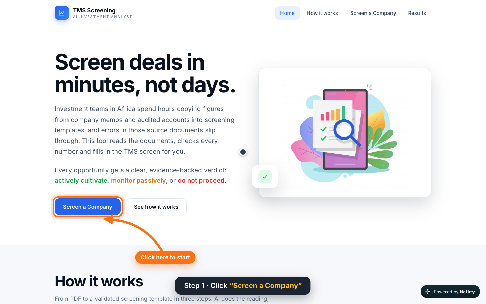
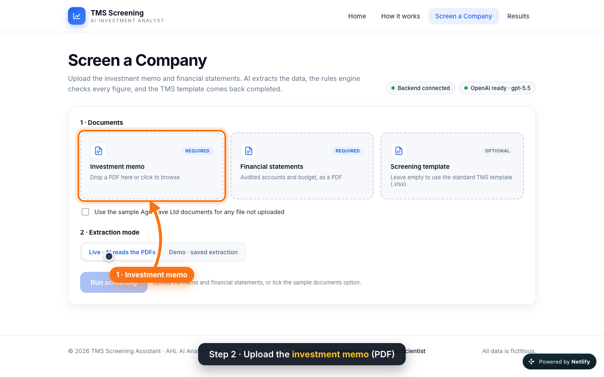
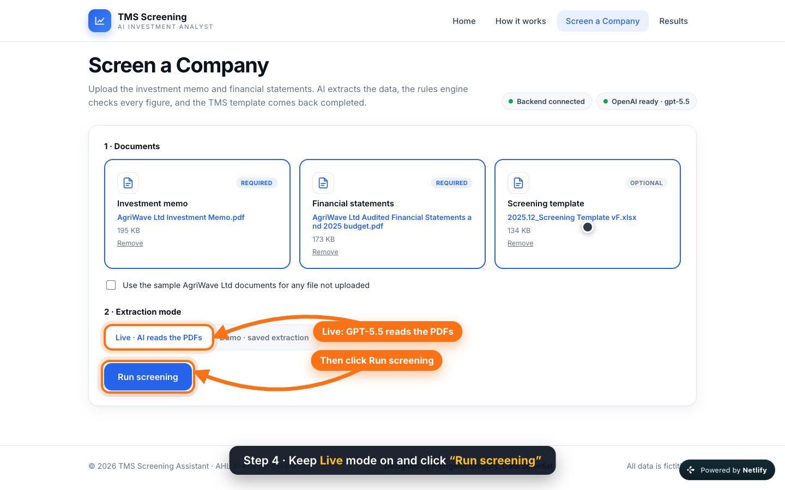
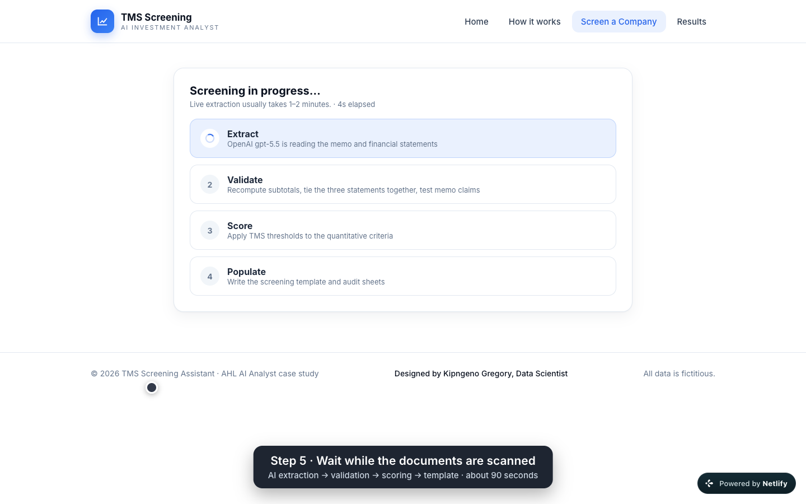
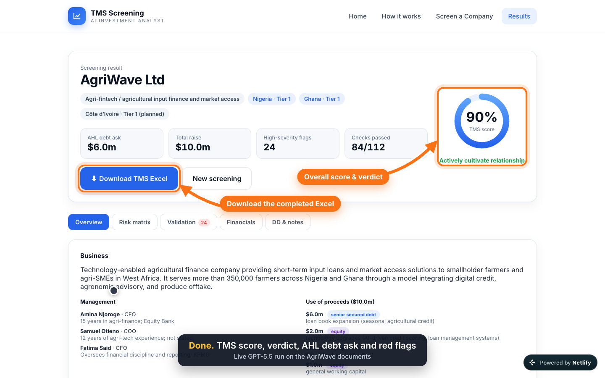
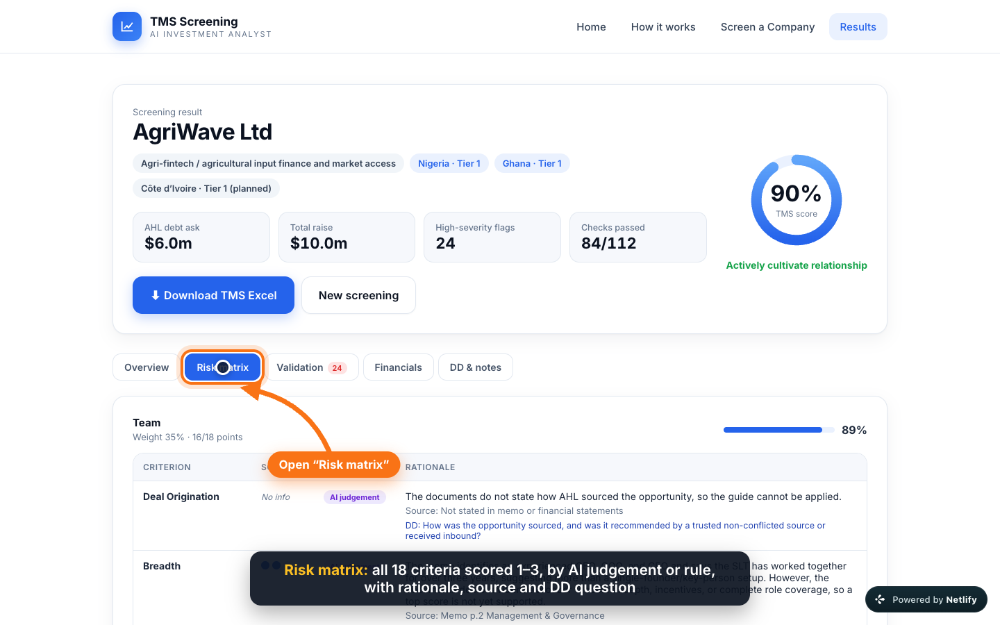
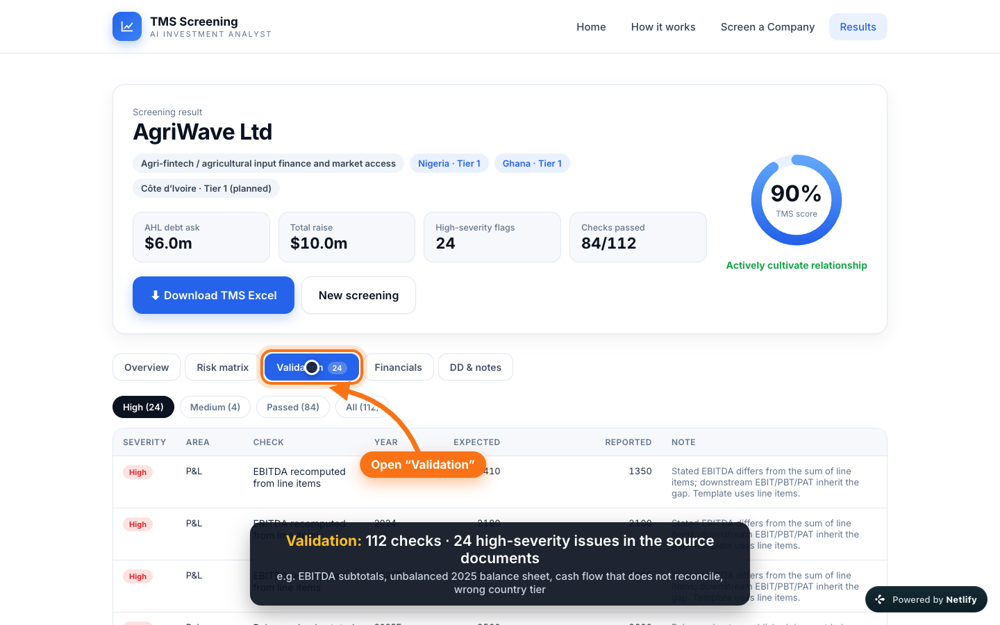
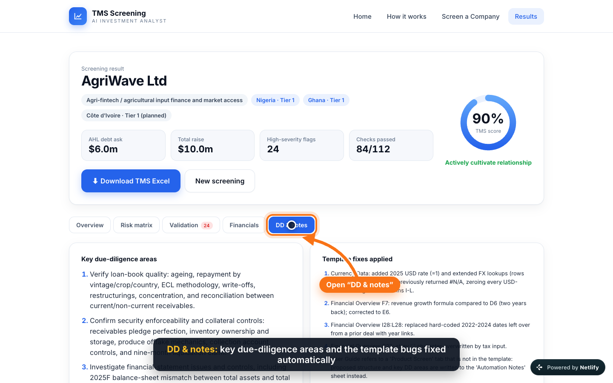
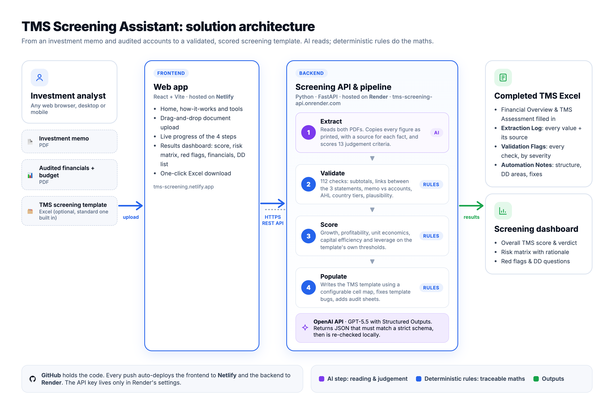

# TMS Screening Assistant

**Turns an investment memo and a company's audited accounts into a completed, checked screening template in about 90 seconds.**

| | |
|---|---|
| 🌐 **Live app** | **https://tms-screening.netlify.app** |
| ⚙️ **Backend API** | **https://tms-screening-api.onrender.com** (health check: [`/api/health`](https://tms-screening-api.onrender.com/api/health)) |
| 🎬 **Demo video** | **https://youtu.be/tPE6HUpi7Tw** (under 2 minutes, a live run end to end; also in [`docs/demo/`](docs/demo/TMS_Screening_Demo.mp4)) |
| 📄 **Sample output** | [`backend/output/AgriWave_Ltd_TMS_Screening.xlsx`](backend/output/AgriWave_Ltd_TMS_Screening.xlsx) |

Built for the **AHL Venture Partners AI Analyst technical case study**. The sample company is *AgriWave Ltd*; all data is fictitious.

### ▶️ Watch the demo

[](https://youtu.be/tPE6HUpi7Tw)

*A live, end-to-end run on the deployed app: uploading the AgriWave documents, scanning with GPT-5.5, reviewing the results and downloading the completed TMS Excel.*

---

## 1. The problem it solves

When a new deal comes in, an analyst opens the company's investment memo and financial statements, then copies dozens of figures and facts by hand into AHL's screening template (TMS). This is slow, and it has a hidden risk: **company documents often contain errors and inconsistencies**, and manual copying passes them straight into the screen.

The TMS Screening Assistant does this first pass automatically:

1. **Reads** the memo and financial statements. Every number is copied exactly as printed, and every fact records where it came from.
2. **Checks** the documents. It runs 112 checks: do the subtotals add up, do the three financial statements agree with each other, does the memo match the accounts, and are the memo's claims true?
3. **Scores** the opportunity on the TMS risk matrix (Team, Business Model, Ability to Scale).
4. **Fills in** the TMS Excel template, ready for the deal-team meeting, with an audit trail of every value.

The analyst's time goes on **judgement and due diligence**, not data entry.

---

## 2. Results on the AgriWave case

| What we measured | Result |
|---|---|
| Extraction accuracy (347 figures and facts, compared with a hand-checked reference) | **347 / 347 correct (100%)** |
| Time from upload to completed template | **about 90 seconds** |
| Checks run on the source documents | **112** (84 passed, 4 medium, **24 high-severity issues**) |
| Overall TMS score | **82–90% across live runs: always "Actively cultivate relationship"** |

*Why the score varies slightly:* all figures and rule-based scores are identical on every run. Only the AI's judgement on a few qualitative criteria (e.g. team breadth, reputation) moves by one point, depending on how sceptical it is of claims made only in the company's own memo.

**Issues the tool caught in the AgriWave documents** (the full list is in the *Validation* tab and the Excel *Validation Flags* sheet):

- **The funding ask contradicts itself.** The introduction asks for "$10m senior debt", but the use of proceeds is **$6m senior secured debt + $4m equity**. AHL's ask is taken as the $6m debt.
- **Wrong country tier.** The memo says Ghana is Tier 2. AHL's own Country Gating Screen lists **Ghana as Tier 1**.
- **P&L subtotals don't add up for 2023–2025.** Stated EBITDA is lower than the sum of its line items, so profit is understated by $60k–$140k.
- **The 2025 balance sheet doesn't balance** (off by $100k), and retained earnings have an unexplained $600k gap.
- **The cash flow statement doesn't reconcile** to the change in cash in any year, and operating cash flow is missing for 2023–2025.
- **Interest income is implausible.** Interest is said to be 65–72% of revenue, which implies a yield of about 270% a year on the reported loan book. This is the top question for due diligence.
- **The capital-efficiency claim depends on the definition.** The memo's "$320k per $1m" only holds if "capital" means the loan book; on equity + debt it is about 22%.

---

## 3. How to use it

### Step 1: Open the app and click **"Screen a Company"**


### Step 2: Upload the documents
Drag each file onto its box, or click the box to browse:
- **Investment memo** (PDF, required)
- **Financial statements** (PDF, required)
- **Screening template** (Excel, optional: the standard TMS template is used if you leave it empty)



### Step 3: Keep **Live** mode on and click **"Run screening"**
*Live* means GPT-5.5 reads your PDFs. *Demo* replays a saved AgriWave extraction (useful without an API key).



### Step 4: Wait while the documents are scanned (about 90 seconds)
The progress screen shows each of the four steps as it runs.



### Step 5: Review the results
The top card shows the **overall TMS score and verdict**, the AHL debt ask, the number of red flags, and a **Download TMS Excel** button.



Use the tabs to go deeper:

| Tab | What it shows |
|---|---|
| **Overview** | Business description, management, use of proceeds, and the impact screens (impact, climate, 2X gender, local founder, security) |
| **Risk matrix** | All 18 criteria scored 1–3, each with its rationale, source and the DD question to ask |
| **Validation** | Every check, filterable by severity, showing expected vs reported values |
| **Financials** | Five years of key figures as reported |
| **DD & notes** | Key due-diligence areas and the template bugs fixed automatically |





### Step 6: Download the completed Excel
The downloaded file is the TMS template, filled in, plus three extra sheets:
- **Extraction Log**: every value written, where it came from, and which cell it went into
- **Validation Flags**: every check, ranked by severity
- **Automation Notes**: proposed deal structure, key DD areas, template fixes and run details

---

## 4. How it works



In plain terms:

| Step | Who does it | What happens |
|---|---|---|
| **1. Extract** | **AI** (OpenAI GPT-5.5) | Reads both PDFs and fills in a strict, pre-defined form: every figure exactly as printed, every fact with its page/section, and a judgement score for the 13 qualitative criteria (team, governance, moat, …). |
| **2. Validate** | **Rules** | Recomputes every subtotal, ties the P&L, balance sheet and cash flow together, compares the memo with the accounts, checks country tiers against AHL's Gating Screen, and tests claims for plausibility. |
| **3. Score** | **Rules** | Scores revenue growth, profitability, unit economics, capital efficiency and leverage using the template's own thresholds. |
| **4. Populate** | **Rules** | Writes everything into the TMS template using a configurable cell map, and adds the audit sheets. |

**Why split AI and rules?** The AI is good at *reading* messy documents and making *judgements*. Arithmetic and threshold scoring should be exact and repeatable, so they're done by ordinary code. That means **every number in the template can be traced back to its source and recalculated**.

**Where it runs:**
- The **web app** (frontend) is hosted on **Netlify**.
- The **screening API** (backend) is hosted on **Render** and calls the **OpenAI API**.
- The code lives on **GitHub**, and every push redeploys both automatically.
- The OpenAI key is stored only in Render's settings, never in the code.

---

## 5. Assumptions and limitations

- **Years.** The template has four year columns: FY2022–FY2024 are audited and FY2025 is the company's budget. FY2021 is used only for the 3-year growth test.
- **Figures are entered as reported.** Where the documents contradict themselves, the template uses the line items and the gap is flagged, not silently fixed.
- **Judgement scores rely only on the documents.** Items that need a management call or AHL's portfolio list (deal source, competition with the portfolio) are left blank for the deal lead. The AI is told to be sceptical of claims made only in the company's own memo.
- **Template issues fixed automatically**, and documented in the Excel:
  - The FX lookups didn't cover 2025.
  - One revenue-growth formula pointed at the wrong year.
  - Some balance-sheet dates were left over from a previous deal.
  - There was a stray character in a cell.
  - The User Guide refers to a *Product Screen* tab that doesn't exist.
- **Demo-grade hosting.** Jobs are kept in memory, and the free Render plan sleeps when idle. A production version would add a database, user logins and document storage.

---

## 6. For technical readers

<details>
<summary><b>Project structure</b></summary>

```
AI Analyst Test/
├── README.md                  ← this file
├── render.yaml                ← Render Blueprint (backend hosting)
├── netlify.toml               ← Netlify build settings (frontend hosting)
├── docs/
│   ├── architecture.html      ← source of the architecture diagram
│   ├── images/                ← architecture.png and app screenshots
│   └── demo/                  ← demo video
├── (case-study documents: memo PDF, financials PDF, screening template, case study PDF)
├── backend/                   Python · FastAPI · OpenAI
│   ├── api.py                 REST API used by the web app
│   ├── run.py                 same pipeline from the command line
│   ├── src/
│   │   ├── schema.py          the extraction "form" (strict JSON schema)
│   │   ├── extract.py         step 1: OpenAI reads the PDFs
│   │   ├── validate.py        step 2: 112 rule-based checks
│   │   ├── score.py           step 3: quantitative TMS scoring
│   │   ├── populate.py        step 4: writes the Excel template
│   │   └── pipeline.py        runs steps 1-4
│   ├── config/field_map.yaml  template cell map: edit this, not code, if the template layout changes
│   └── tests/                 hand-checked reference extraction + accuracy checker
└── frontend/                  React (Vite) web app
    └── src/                   pages: Home, Screen a Company, Results
```
</details>

<details>
<summary><b>Run it locally</b></summary>

Requirements: Python 3.10+, Node 18+, and an OpenAI API key with billing credit (optional: demo mode works without one).

```bash
# Backend (http://localhost:8000)
cd backend
python3 -m venv .venv && .venv/bin/pip install -r requirements.txt
cp .env.example .env            # then add OPENAI_API_KEY=sk-...
.venv/bin/uvicorn api:app --port 8000

# Frontend (http://localhost:5173), in a second terminal
cd frontend
npm install && npm run dev
```

Command line, with no web app:
```bash
cd backend
.venv/bin/python run.py          # live run on the sample documents
.venv/bin/python run.py --demo   # no API key needed
.venv/bin/python tests/compare_to_reference.py output/extraction.json   # accuracy check
```
</details>

<details>
<summary><b>Configuration</b></summary>

| Where | Variable | Purpose |
|---|---|---|
| `backend/.env` / Render | `OPENAI_API_KEY` | OpenAI key (required for live mode) |
| `backend/.env` / Render | `OPENAI_MODEL` | Extraction model, default `gpt-5.5` |
| `backend/.env` / Render | `OPENAI_REASONING_EFFORT` | `low` / `medium` / `high` (default `medium`) |
| `backend/.env` / Render | `ALLOWED_ORIGINS` | Extra frontend URLs allowed to call the API (the Netlify site and localhost are always allowed) |
| `frontend/.env.production` / Netlify | `VITE_API_URL` | Backend URL used by the deployed web app |
| `frontend/.env` | `BACKEND_URL` | Where the local dev server sends `/api` requests (default `http://127.0.0.1:8000`) |
</details>

<details>
<summary><b>API</b></summary>

| Method | Path | Description |
|---|---|---|
| `GET` | `/api/health` | Status, model, whether the API key is configured |
| `POST` | `/api/jobs` | multipart: `memo` (pdf), `financials` (pdf), `template` (xlsx, optional), `mode` = `live`\|`demo`, `use_samples` |
| `GET` | `/api/jobs/{id}` | Job status, current step and, when done, the full results |
| `GET` | `/api/jobs/{id}/download` | The completed TMS Excel file |
</details>

<details>
<summary><b>Deployment</b></summary>

- **Backend → Render.** In the Render dashboard choose **New → Blueprint** and pick this repo; it uses `render.yaml`. Set `OPENAI_API_KEY` in the dashboard. Render installs `backend/requirements.txt` on Python 3.12 and runs `uvicorn api:app` on `$PORT`.
- **Frontend → Netlify.** Import the repo. `netlify.toml` builds `frontend/` with `npm run build` and publishes `frontend/dist`. The backend URL comes from `frontend/.env.production`.
- Every push to `main` redeploys both.
</details>

---

<sub>Designed by Kipngeno Gregory, Data Scientist · Hero illustration on the home page is a third-party image used for demonstration only.</sub>
